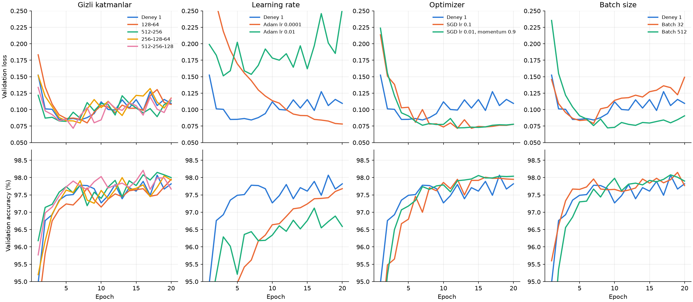
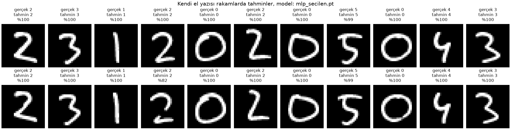

# Ödev 1: MNIST ile MLP tabanlı el yazısı rakam tanıma

Bu klasörde MNIST rakamlarıyla sıfırdan eğitilen MLP modelleri var. Deney 1 temel modeli kuruyor, yapılandırma karşılaştırması da hiperparametrelerin etkisini inceliyor. İki model, öğrenci numarasının el yazısıyla yazılmış hâli üzerinde de denendi. Modellerde yalnızca tam bağlantılı katmanlar bulunuyor. CNN ya da hazır eğitilmiş model yok. Kod PyTorch ile yazıldı.

Öğrenci numarası 23120205043.

## Sonuç özeti

| Ölçüm | Deney 1 | Seçilen model |
| --- | --- | --- |
| Yapılandırma | 256-128, Adam lr 0.001, batch 128 | 256-128, SGD lr 0.1, batch 128 |
| Training loss | 0.0115 | 0.0129 |
| Validation loss | 0.1095 | 0.0715 |
| Training accuracy | %99.62 | %99.75 |
| Validation accuracy | %97.82 | %97.95 |
| Test loss | 0.1077 | 0.0674 |
| Test accuracy | %97.99 | %97.92 |
| Eğitim süresi | 13.4 s, 20 epoch | 7.9 s, 12 epoch |
| Kendi el yazısında accuracy | %95.45, 22 rakamda 21 doğru | %100, 22 rakamda 22 doğru |

Deney 1'in değerleri 20. epoch'un sonundan, seçilen modelinkiler 12. epoch'tan. Seçilen model, karşılaştırmada validation loss'u en düşük çıkan yapılandırma. Bu yapılandırma karşılaştırmada 20 epoch eğitildi ve 12. epoch'taki ağırlıkları alındı, tablodaki 7.9 saniye ilk 12 epoch'un süresi. Test kümesi iki model için de eğitim bittikten sonra birer kez ölçüldü. Süreler NVIDIA RTX 5080 üzerinde.

## Çalıştırma

Ortamın kurulumu [kök README](../README.md) dosyasında. Komutlar proje kökünde, `.venv` etkinken çalışır:

```powershell
python odev1_mnist_mlp/deney1_temel_mlp.py              # Deney 1: eğitim, test, grafikler, model
python odev1_mnist_mlp/yapilandirma_karsilastirma.py    # karşılaştırma, seçim ve seçilen modelin testi
python odev1_mnist_mlp/el_yazisi_hazirla.py             # fotoğrafları 28 × 28 rakamlara çevirir
python odev1_mnist_mlp/el_yazisi_tahmin.py              # rakamları Deney 1 modeliyle sınıflandırır
python odev1_mnist_mlp/el_yazisi_tahmin.py --model odev1_mnist_mlp/modeller/mlp_secilen.pt --cikti odev1_mnist_mlp/sonuclar/karsilastirma/el_yazisi
```

İlk komut MNIST'i `veri/` klasörüne indirir. Bu klasör yaklaşık 64 MB ve Git'e girmiyor. Karşılaştırma 13 eğitim yapıyor ve RTX 5080'de yaklaşık 3.5 dakika sürüyor. `modeller/` klasöründeki iki model dosyası bu betiklerin çıktısı. Eğitim betikleri her çalıştırmada modeli sıfırdan eğitip bu dosyaların üzerine yazıyor. Dosyalar repoda olduğu için el yazısı adımları eğitim beklemeden de çalışır. `el_yazisi_hazirla.py`, her fotoğrafta numaranın tek satır hâlinde yazılı olduğunu varsayıyor.

Kod CUDA varsa ekran kartını, yoksa CPU'yu kullanıyor. Deney 1 CPU'da çalıştırıldığında eğitim 11.5 saniye sürdü ve test accuracy %97.79 çıktı. Ekran kartındaki %97.99'la arasındaki küçük fark, iki cihazın kayan nokta hesaplarındaki yuvarlama farklarının 20 epoch boyunca birikmesinden geliyor. Karşılaştırma CPU'da çalıştırıldığında da aynı yapılandırma ve aynı epoch seçildi, SGD lr 0.1 ve 12. epoch. Seçilen modelin test accuracy'si yine %97.92 çıktı.

## Veri ayrımı

MNIST'te 28 × 28 boyutlu, gri seviyeli 60 000 eğitim ve 10 000 test görüntüsü var. Görüntüler 0'dan 9'a kadar 10 sınıfa ayrılıyor.

| Küme | Kaynak | Görüntü | Kullanım |
| --- | --- | --- | --- |
| Train | MNIST eğitim kısmı | 50 000 | Ağırlıkların güncellenmesi |
| Validation | MNIST eğitim kısmından ayrıldı | 10 000 | Her epoch sonunda ölçüm, epoch ve yapılandırma seçimi |
| Test | MNIST'in resmî test kümesi | 10 000 | Eğitim bittikten sonra tek ölçüm |

60 000 görüntülük eğitim kısmı seed 42 ile karıştırıldı. İlk 10 000 görüntü validation, kalan 50 000 görüntü train kümesi oldu. Kod, iki kümenin ortak görüntü içermediğini `assert` ile kontrol ediyor. Sınıf dağılımı üç kümede de dengeli:

| Sınıf | 0 | 1 | 2 | 3 | 4 | 5 | 6 | 7 | 8 | 9 |
| --- | --- | --- | --- | --- | --- | --- | --- | --- | --- | --- |
| Train | 4930 | 5668 | 4942 | 5089 | 4860 | 4507 | 4923 | 5254 | 4846 | 4981 |
| Validation | 993 | 1074 | 1016 | 1042 | 982 | 914 | 995 | 1011 | 1005 | 968 |
| Test | 980 | 1135 | 1032 | 1010 | 982 | 892 | 958 | 1028 | 974 | 1009 |

Test kümesi model geliştirmede kullanılmadı. İki eğitim betiği de test kümesini eğitim bittikten sonra yüklüyor, eğitim boyunca test görüntüleri bellekte bile yok. Deney 1'in ayarları sonuçlar görülmeden belirlendi. Karşılaştırmada yapılandırma ve epoch yalnızca validation loss'a göre seçildi.

Pikseller 255'e bölünüp [0, 1] aralığına getiriliyor, sonra `(x - 0.1306) / 0.3081` ile normalize ediliyor. Ortalama ve standart sapma yalnızca train kümesinden hesaplandı. Böylece validation ve test kümelerinden normalizasyona bilgi sızmıyor. Validation, test ve el yazısı görüntülerinde de aynı iki değer kullanılıyor.

## Deney 1: temel MLP

### Model

```text
Girdi 28 × 28   ->  Flatten, 784 değer
Linear 784 -> 256 + ReLU    gizli katman 1
Linear 256 -> 128 + ReLU    gizli katman 2
Linear 128 -> 10            çıkış katmanı, her rakam için bir logit
```

Modelde 235 146 eğitilebilir parametre var. Çıkış katmanında softmax yok, çünkü `CrossEntropyLoss` logitlere log-softmax'i kendisi uyguluyor. Tahmin, en yüksek logit'e sahip sınıf oluyor. Model sınıfı [model.py](model.py) içinde.

### Hiperparametreler

| Hiperparametre | Değer |
| --- | --- |
| Gizli katmanlar | 2 katman, 256 ve 128 nöron |
| Aktivasyon | ReLU |
| Loss fonksiyonu | CrossEntropyLoss |
| Optimizer | Adam, β1 = 0.9 ve β2 = 0.999 (PyTorch varsayılanları) |
| Learning rate | 0.001 |
| Batch size | 128 |
| Epoch | 20 |
| Train / validation / test | 50 000 / 10 000 / 10 000 |
| Normalizasyon | mean 0.1306, std 0.3081, train kümesinden |
| Ağırlık başlatma | PyTorch `nn.Linear` varsayılanı |
| Düzenlileştirme | Yok, dropout ve weight decay kullanılmadı |
| Seed | 42 |

Aynı değerler [deney1_temel_mlp.py](deney1_temel_mlp.py) içindeki `HPARAMS` sözlüğünde ve [metrikler.json](sonuclar/deney1/metrikler.json) dosyasında kayıtlı.

### Eğitim

Training loss ve accuracy, epoch boyunca mini-batch'lerde hesaplanan değerlerin ortalaması. Model epoch içinde değiştiği için bu ortalama, epoch sonundaki modelden biraz kötü çıkıyor. Validation ise epoch bittikten sonra ölçülüyor. İlk epoch'ta training accuracy %91.36 ile validation'ın %94.96'sının altında kaldı, sebebi bu.

Eğitim toplam 13.4 saniye sürdü. Her epoch sonundaki validation ölçümü bu süreye dahil, test ölçümü ve dosya kayıtları dahil değil. Bir epoch 0.6 ile 0.9 saniye arasında sürüyor. Deney birkaç kez çalıştırıldı ve loss ile accuracy değerleri her seferinde birebir aynı çıktı.

| Epoch | Train loss | Val loss | Train acc (%) | Val acc (%) | Süre (s) |
| --- | --- | --- | --- | --- | --- |
| 1 | 0.2942 | 0.1524 | 91.36 | 94.96 | 0.93 |
| 2 | 0.1143 | 0.1012 | 96.54 | 96.76 | 0.61 |
| 3 | 0.0768 | 0.1005 | 97.58 | 96.93 | 0.61 |
| 4 | 0.0549 | 0.0851 | 98.29 | 97.35 | 0.61 |
| 5 | 0.0424 | 0.0852 | 98.67 | 97.49 | 0.69 |
| 6 | 0.0326 | 0.0865 | 98.95 | 97.51 | 0.64 |
| 7 | 0.0266 | 0.0843 | 99.14 | 97.78 | 0.62 |
| 8 | 0.0219 | 0.0879 | 99.28 | 97.77 | 0.61 |
| 9 | 0.0203 | 0.0940 | 99.31 | 97.68 | 0.65 |
| 10 | 0.0198 | 0.1119 | 99.31 | 97.27 | 0.63 |
| 11 | 0.0170 | 0.1002 | 99.43 | 97.48 | 0.62 |
| 12 | 0.0128 | 0.0994 | 99.59 | 97.80 | 0.63 |
| 13 | 0.0157 | 0.1149 | 99.46 | 97.39 | 0.62 |
| 14 | 0.0162 | 0.1024 | 99.43 | 97.71 | 0.63 |
| 15 | 0.0113 | 0.1153 | 99.60 | 97.61 | 0.70 |
| 16 | 0.0092 | 0.0987 | 99.70 | 97.89 | 0.64 |
| 17 | 0.0105 | 0.1273 | 99.64 | 97.49 | 0.69 |
| 18 | 0.0125 | 0.1062 | 99.61 | 98.07 | 0.62 |
| 19 | 0.0098 | 0.1155 | 99.67 | 97.67 | 0.79 |
| 20 | 0.0115 | 0.1095 | 99.62 | 97.82 | 0.89 |

Tablo [egitim_gecmisi.csv](sonuclar/deney1/egitim_gecmisi.csv) dosyasından.


### Deney 1'in yorumu

Training loss 20 epoch boyunca 0.294'ten 0.0115'e düştü. Validation loss ise en düşük değerini 7. epoch'ta gördü, 0.0843. Sonra inip çıkarak 0.11 civarına yükseldi. Model 7. epoch'tan sonra train kümesini ezberlemeye devam ediyor ama yeni görüntülerde ilerlemiyor. Overfitting burada başlıyor.

Validation accuracy aynı dönemde %97.3 ile %98.1 arasında kaldı. Loss yükselirken accuracy'nin düşmemesi ilk bakışta tuhaf geliyor. Sebebi, modelin yanlış bildiği örneklerde gittikçe daha emin olması. Cross-entropy yanlış sınıfa verilen yüksek olasılığı ağır cezalandırıyor. Accuracy ise sadece en yüksek skorlu sınıfın doğru olup olmadığına bakıyor.

Son epoch'ta training ve validation accuracy arasında 1.8 puanlık fark var. Test accuracy %97.99 ile validation'a çok yakın, yani validation kümesi modelin MNIST'teki yeni görüntülerde ne yapacağını iyi tahmin ediyor. Validation loss'un 7. epoch'tan sonra yükselmesi, epoch sayısının da seçilmesi gereken bir hiperparametre olduğunu gösteriyor. Karşılaştırmada her yapılandırmanın epoch'u bu yüzden validation loss'a göre seçildi.

## Yapılandırma karşılaştırması

Ödevin amacı model yapılandırmalarının performansını karşılaştırmayı da içeriyor. [yapilandirma_karsilastirma.py](yapilandirma_karsilastirma.py) Deney 1'in ayarlarından her seferinde yalnızca birini değiştiriyor. Bütün yapılandırmalar Deney 1'in kurallarına uyuyor: en az 2 gizli katman, ReLU, CrossEntropyLoss ve Adam ya da SGD.

Her yapılandırma aynı train/validation ayrımıyla, seed 42 ile 20 epoch eğitiliyor. Betik her epoch sonunda validation'ı ölçüyor ve validation loss'un en düşük olduğu epoch'un ağırlıklarını saklıyor. Böylece epoch sayısı da validation'a göre seçilmiş oluyor. Sonunda en düşük validation loss'u veren yapılandırma seçiliyor ve test kümesi yalnızca bu model için bir kez ölçülüyor. Accuracy sadece en yüksek skorlu sınıfa baktığı için seçim ölçütü loss oldu. Loss, modelin doğru sınıfa verdiği olasılığı da hesaba katıyor.

### Seed kontrolü

Farkların ne kadarının şanstan geldiğini görmek için Deney 1'in ayarları iki farklı seed ile daha eğitildi. Train/validation ayrımı aynı kaldı, yalnızca ağırlıkların başlangıç değerleri ve batch sırası değişti.

| Seed | En iyi epoch | Val loss | Val acc (%) |
| --- | --- | --- | --- |
| 42 | 7 | 0.0843 | 97.78 |
| 43 | 7 | 0.0860 | 97.74 |
| 44 | 9 | 0.0800 | 97.97 |

Aynı ayarla bile en düşük validation loss 0.080 ile 0.086, o epoch'taki validation accuracy %97.74 ile %97.97 arasında değişiyor. Bu aralıktan küçük farklar tek bir seed'le yorumlanamaz.

### Sonuçlar

| Grup | Yapılandırma | En iyi epoch | Val loss | Val acc (%) | 20. epoch val loss | 20. epoch val acc (%) | Süre (s) |
| --- | --- | --- | --- | --- | --- | --- | --- |
| Temel | Deney 1 | 7 | 0.0843 | 97.78 | 0.1095 | 97.82 | 13.2 |
| Gizli katmanlar | 128-64 | 8 | 0.0798 | 97.70 | 0.1080 | 97.95 | 13.0 |
| Gizli katmanlar | 512-256 | 5 | 0.0822 | 97.74 | 0.1133 | 98.00 | 13.1 |
| Gizli katmanlar | 256-128-64 | 7 | 0.0798 | 97.91 | 0.1176 | 97.93 | 14.1 |
| Gizli katmanlar | 512-256-128 | 6 | 0.0717 | 97.90 | 0.1172 | 97.67 | 18.3 |
| Learning rate | Adam lr 0.0001 | 20 | 0.0782 | 97.68 | 0.0782 | 97.68 | 24.9 |
| Learning rate | Adam lr 0.01 | 3 | 0.1514 | 96.29 | 0.2528 | 96.59 | 15.8 |
| Optimizer | SGD lr 0.1, seçildi | 12 | 0.0715 | 97.95 | 0.0778 | 97.95 | 12.8 |
| Optimizer | SGD lr 0.01, momentum 0.9 | 12 | 0.0723 | 97.91 | 0.0778 | 98.04 | 12.0 |
| Batch size | Batch 32 | 7 | 0.0790 | 97.96 | 0.1492 | 97.77 | 36.8 |
| Batch size | Batch 512 | 9 | 0.0723 | 97.76 | 0.0906 | 97.90 | 7.3 |

Val loss ve val acc sütunları en iyi epoch'taki değerler. Süre, 20 epoch'un tamamı için. Bütün epoch'lar [epoch_gecmisi.csv](sonuclar/karsilastirma/epoch_gecmisi.csv), özet [ozet.csv](sonuclar/karsilastirma/ozet.csv) dosyasında.



Grafikte farkları görebilmek için eksenler kısıtlandı. Adam lr 0.01'in son epoch'ları ve Adam lr 0.0001'in ilk epoch'ları loss ekseninin dışında kalıyor.

### Karşılaştırmanın yorumu

Gizli katmanların genişliği ve sayısı değişince sonuçların çoğu seed aralığının içinde kaldı. 512-256-128'in 0.0717'lik değeri tek bir epoch'taki düşüşten geliyor. 10. epoch'tan sonra eğrisi 0.085 ile 0.119 arasında, Deney 1'inkine benziyor. 20 epoch'luk bu eğitimde ağın boyutu belirleyici olmadı.

Learning rate en büyük farkı yaratan ayar. Adam için 0.01 fazla yüksek. Validation loss hiçbir epoch'ta 0.15'in altına inmedi ve 20. epoch'ta 0.25'e çıktı. 0.0001 ise yavaş kaldı. En iyi değer son epoch'ta geldi ve eğri hâlâ iniyordu, bu learning rate için 20 epoch yetmiyor.

SGD ilk epoch'larda Adam'dan yavaş öğrendi ama overfitting'e de daha geç girdi. 10. epoch'tan sonra iki SGD yapılandırmasında da validation loss 0.072 ile 0.087 arasında kaldı. Deney 1'de aynı dönemde 0.099 ile 0.127 arasındaydı.

Batch 32'de epoch başına 4 kat daha fazla güncelleme yapılıyor ve model daha erken ezberliyor. Validation loss 7. epoch'tan sonra hızla 0.15'e çıktı. Batch 512'de güncelleme sayısı 4 kat az, overfitting de daha geç ve daha hafif geldi. Eğitim süresi 36.8 saniyeden 7.3 saniyeye indi.

Gruplar arasında ortak bir örüntü var. Öğrenmeyi yavaşlatan değişiklikler, yani SGD, küçük learning rate ve büyük batch, overfitting'i geciktirdi ve en düşük validation loss'u indirdi. Accuracy ise neredeyse hiç değişmedi. Adam lr 0.01 dışındaki bütün yapılandırmaların en iyi epoch'taki validation accuracy'si %97.7 ile %98.0 arasında, yani seed aralığının içinde.

### Seçilen model

Validation loss'u en düşük yapılandırma SGD lr 0.1 oldu, en iyi epoch'u 12. İkinci sıradaki 512-256-128 ile arasındaki fark 0.0002, seed aralığının çok altında. Bu seçim, aynı seviyedeki birkaç yapılandırma arasından önceden belirlenen kurala göre yapıldı. Seçilen modelin ağırlıkları `modeller/mlp_secilen.pt`, ayarları [secilen_model.json](sonuclar/karsilastirma/secilen_model.json) dosyasında. İki modelin değerleri yan yana [Sonuç özeti](#sonuç-özeti) tablosunda.

Test accuracy değişmedi, %97.92 ile %97.99 arasındaki fark seed aralığının içinde. Değişen test loss oldu, 0.108'den 0.067'ye indi. İki modelin train loss'u birbirine yakın, 0.0115 ve 0.0129. Validation ve test loss'u ise seçilen modelde belirgin şekilde düşük. Accuracy aynı kalıp loss düştüğüne göre, seçilen model doğru sınıfa ortalamada daha yüksek olasılık veriyor. Validation tarafındaki iyileşme accuracy'de değil, loss'ta.

## Kendi el yazısı

### Fotoğraflar

Numara beyaz kâğıda mavi tükenmez kalemle bir kez yazıldı ve telefonla iki fotoğrafı çekildi. İki fotoğrafta da aynı yazı var, değişen sadece ışık ve kadraj. [ogrenci_no_1.jpg](el_yazisi/ham/ogrenci_no_1.jpg) daha karanlık, [ogrenci_no_2.jpg](el_yazisi/ham/ogrenci_no_2.jpg) daha aydınlık. Rakamların çevresindeki kâğıdın gri değeri birincide 123, ikincide 140.

Fotoğraflar repoya eklenmeden önce metadata'ları temizlendi. EXIF'te GPS konumu, telefon modeli ve çekim zamanı vardı, telefon ayrıca XMP verisi ve gömülü ek görüntüler eklemişti. Fotoğraflar yalnızca piksellerinden yeniden kaydedildi. Numara yatay okunsun diye 90° döndürüldü ve çekim tarihini içeren dosya adları değiştirildi.

### Hazırlama

[el_yazisi_hazirla.py](el_yazisi_hazirla.py) ödevdeki dört koşulu şöyle karşılıyor:

| Ödevdeki koşul | Yapılan işlem |
| --- | --- |
| Gri tonlama | Fotoğraf `cv2.IMREAD_GRAYSCALE` ile tek kanallı okunuyor. |
| MNIST'le uyumlu renkler | Önce kâğıttaki ışık ve gölge farkı gideriliyor, sonra renkler ters çevriliyor. Arka plan siyah (0), rakam beyaz (255) oluyor. |
| 28 × 28 boyut | Rakamın siyah-beyaz maskesi en-boy oranı korunarak 20 × 20 kutuya sığdırılıyor. Küçültme kenarlarda gri tonlar oluşturuyor. Sonra rakam, ağırlık merkezi 28 × 28 alanın ortasına gelecek şekilde kaydırılıyor. MNIST de NIST'in siyah-beyaz görüntülerinden bu yöntemle hazırlanmış ([MNIST sayfasının arşiv kopyası](https://web.archive.org/web/20190602004806/http://yann.lecun.com/exdb/mnist/)). |
| Normalizasyon | [el_yazisi_tahmin.py](el_yazisi_tahmin.py) pikselleri 255'e bölüyor ve train kümesinin mean ile std değeriyle normalize ediyor. |

Betikte iki adım daha var. Rakamları bağlı bileşen analiziyle birbirinden ayırıp soldan sağa sıralıyor. Kalem çizgisi MNIST'tekinden inceyse çizgiyi kalınlaştırıyor. MNIST'te çizgi kalınlığı rakamın uzun kenarının yaklaşık 0.117'si, bu oran MNIST eğitim görüntülerinden ölçüldü.

Betik ara adımları her fotoğraf için bir görsele kaydediyor. 28 × 28 rakamlar `el_yazisi/islenmis/` klasöründe, etiketleri `etiketler.csv` dosyasında.


Betik iki fotoğrafta da tek satır ve 11 rakam buldu. Kâğıttaki eski kalem izleri ve kırışıklıklar rakam olarak seçilmedi.

### Tahminler

| Fotoğraf | Gerçek | Deney 1 | Seçilen model |
| --- | --- | --- | --- |
| ogrenci_no_1.jpg, karanlık | 23120205043 | 23120205043, 11 / 11 | 23120205043, 11 / 11 |
| ogrenci_no_2.jpg, aydınlık | 23120205043 | 23130205043, 10 / 11 | 23120205043, 11 / 11 |
| Toplam | | 21 / 22, %95.45 | 22 / 22, %100 |




Deney 1 modeli 21 rakamı yaklaşık %100 olasılıkla doğru bildi. Tek hata aydınlık fotoğrafın 4. rakamında. Model bu 2'yi %71 olasılıkla 3 sandı, karanlık fotoğraftaki aynı 2'yi ise %100 olasılıkla doğru bilmişti.

Hata modelden önce, eşikleme adımında oluşuyor. Işık düzeltmesi iki fotoğraf arasındaki parlaklık farkının çoğunu siliyor. Mürekkebin kâğıda oranı birincide 0.43, ikincide 0.44. Otsu eşiği ise her fotoğrafın kendi histogramından hesaplanıyor ve karanlık fotoğrafta 80, aydınlık fotoğrafta 89 çıktı. Eşik yükselince 2'nin çapraz çizgisindeki ince bir bölüm mürekkep sayılmadı ve rakam ikiye bölündü. 28 × 28 görüntüde üstte bir yay, altta bir çizgi kaldı. Bu şekil 3'ün üst yarısına benziyor.

Seçilen model aynı kopuk 2'yi %81.9 olasılıkla 2 olarak tanıdı ve 22 rakamın hepsini doğru bildi. Bu sonuç seçimi etkilemedi, seçim yalnızca validation loss'a göre yapıldı. 22 rakamlık bir örnekten iki model arasında genel bir üstünlük sonucu da çıkmaz, çünkü fark tek bir rakamdan geliyor.

Eşik bu sonuçlar görüldükten sonra değiştirilmedi. El yazısı fotoğrafları modelin gerçek dünya testi. Sonuca bakıp ön işlemeyi ayarlamak bu veriyi geliştirmede kullanmak anlamına gelirdi.

Tahminlerin tamamı Deney 1 için [tahminler.csv](sonuclar/el_yazisi/tahminler.csv), seçilen model için [tahminler.csv](sonuclar/karsilastirma/el_yazisi/tahminler.csv) dosyasında.

## Genel değerlendirme

İki gizli katmanlı basit bir MLP, MNIST test kümesinde %98'e yakın accuracy'ye ulaştı. Validation ve test sonuçlarının bu kadar yakın çıkması şaşırtıcı değil, çünkü iki kümedeki görüntüler de aynı tarama ve hazırlama sürecinden geçmiş. Karşılaştırmada denenen hiperparametreler accuracy'yi neredeyse hiç değiştirmedi, overfitting'in ne zaman başladığını ve validation loss'u ise belirgin şekilde değiştirdi. Bu boyuttaki MLP'ler için accuracy %98 civarında tavana yaklaşıyor. Hiperparametre seçiminin asıl etkisi loss'ta görülüyor.

El yazısında Deney 1 %95.45, seçilen model %100 accuracy aldı. Bu sayıları MNIST sonuçlarıyla kıyaslamak pek anlamlı değil. 22 rakamın yalnızca 11'i birbirinden farklı, çünkü iki fotoğraf aynı yazıyı gösteriyor ve tek bir hata accuracy'yi 4.5 puan oynatıyor. Numarada 6, 7, 8 ve 9 geçmediği için bu dört rakam hiç denenmedi.

Ödevin en öğretici sonucu, aynı yazının iki fotoğrafta farklı sonuç vermesi. Gerçek dünyadaki veri MNIST'ten sadece yazı stiliyle ayrılmıyor. Kamera, ışık, kalem ve kâğıt da modele giden görüntüyü değiştiriyor. MNIST'teki bütün görüntüler aynı taramadan ve aynı normalizasyondan geçtiği için validation ve test kümeleri train kümesine çok benziyor. Telefon fotoğrafları ise başka bir yoldan geliyor ve ışıktaki küçük bir fark bir çizgiyi koparmaya yetti. Distribution shift'in en net görüldüğü yer burası.

MLP girdiyi 784 ayrı piksel olarak görüyor, rakamın şekli hakkında ayrıca bir bilgisi yok. Ön işlemedeki adımların hepsi bu yüzden görüntüyü MNIST'e olabildiğince benzetmeye çalışıyor. Bu adımlardan sonra rakamların çoğu MNIST örneklerine çok benziyor ve iki model de onları neredeyse kesin bir olasılıkla biliyor. Kopuk 2 gibi alışılmadık bir girdide ise Deney 1 yanlış cevaba %71 olasılık verdi. Softmax olasılığına bakarak bir modelin MNIST'e benzemeyen girdilerde ne kadar güvenilir olduğunu anlamak zor. Seçilen modelin daha düşük test loss'u, olasılıklarının daha az aşırı olduğuna işaret ediyor. Kopuk 2'deki doğru cevabı da bununla uyumlu, ama tek bir örnek bunu kanıtlamaya yetmez.

## Dosyalar

| Dosya | İçerik |
| --- | --- |
| [model.py](model.py) | MLP sınıfı |
| [deney1_temel_mlp.py](deney1_temel_mlp.py) | Deney 1: veri ayrımı, eğitim, test, grafik ve kayıt |
| [yapilandirma_karsilastirma.py](yapilandirma_karsilastirma.py) | Yapılandırma karşılaştırması, seçim ve seçilen modelin testi |
| [el_yazisi_hazirla.py](el_yazisi_hazirla.py) | Fotoğraftan 28 × 28 MNIST biçiminde rakamlar |
| [el_yazisi_tahmin.py](el_yazisi_tahmin.py) | Hazırlanan rakamların sınıflandırılması |
| [sonuclar/deney1/](sonuclar/deney1) | Deney 1'in epoch geçmişi, metrikleri ve grafikleri |
| [sonuclar/karsilastirma/](sonuclar/karsilastirma) | Karşılaştırma tabloları, eğriler, seed kontrolü ve seçilen modelin el yazısı tahminleri |
| [sonuclar/el_yazisi/](sonuclar/el_yazisi) | Ön işleme görselleri ve Deney 1 modelinin el yazısı tahminleri |
| [modeller/](modeller) | Deney 1 modeli (`mlp_deney1.pt`) ve seçilen model (`mlp_secilen.pt`) |
| [el_yazisi/ham/](el_yazisi/ham) | Öğrenci numarasının metadata'sı silinmiş el yazısı fotoğrafları |
| [el_yazisi/islenmis/](el_yazisi/islenmis) | 28 × 28 rakamlar ve etiketleri |
| [requirements.txt](requirements.txt) | Sabitlenmiş paket sürümleri |
