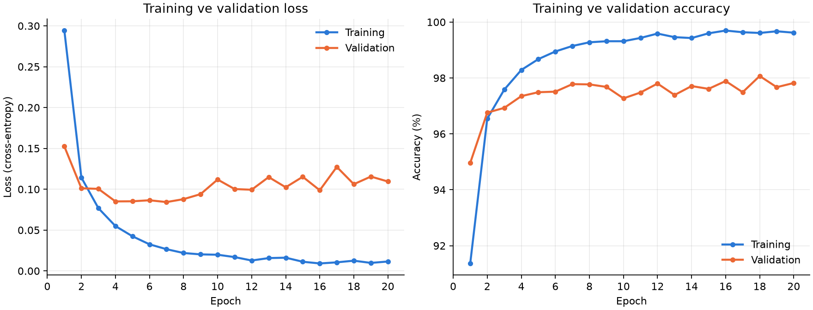
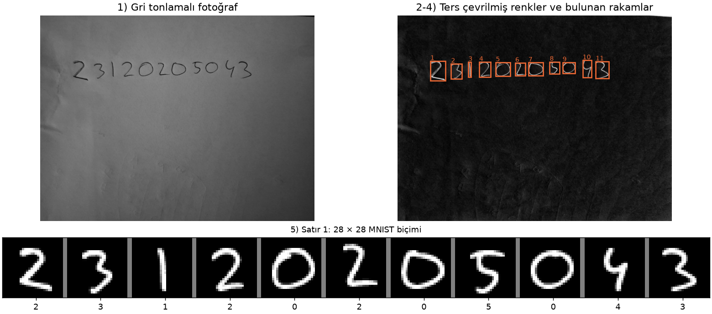
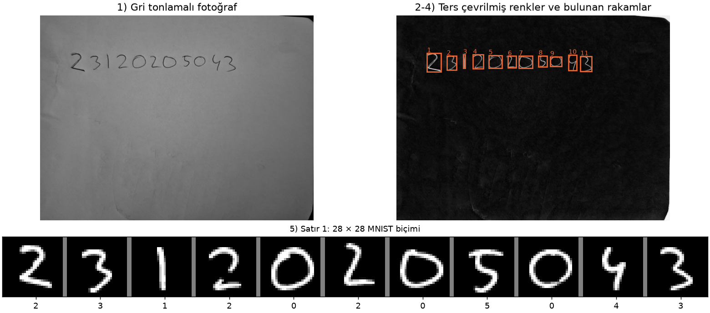
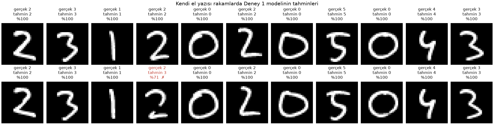

# Ödev 1: MNIST ile MLP tabanlı el yazısı rakam tanıma

Bu klasörde MNIST el yazısı rakamlarıyla sıfırdan eğittiğimiz bir MLP modeli, Deney 1'in sonuçları ve modelin kendi el yazımla yazdığım öğrenci numaram üzerindeki tahminleri bulunuyor. Model yalnızca tam bağlantılı katmanlardan oluşuyor. CNN veya hazır eğitilmiş bir model kullanılmadı. Kütüphane olarak PyTorch kullanıldı.

Öğrenci numarası 23120205043. Teslim tarihi 28 Ekim 23:59.

## Sonuçların özeti

| Ölçüm | Değer |
| --- | --- |
| Training loss | 0.0115 |
| Validation loss | 0.1095 |
| Training accuracy | %99.62 |
| Validation accuracy | %97.82 |
| Test accuracy | %97.99 |
| Eğitim süresi | 14.2 s (20 epoch, NVIDIA RTX 5080) |
| Kendi el yazımda accuracy | %95.45 (22 rakamda 21 doğru) |

Training ve validation değerleri 20. epoch sonundaki değerler. Test accuracy, eğitim bittikten sonra test kümesinde bir kez ölçüldü.

## Çalıştırma

Ortamın kurulumu [kök README](../README.md) dosyasında anlatılıyor. Komutlar proje kökünden, `.venv` etkinken çalıştırılır:

```powershell
python odev1_mnist_mlp/deney1_temel_mlp.py     # Deney 1: eğitim, test, grafikler ve model dosyası
python odev1_mnist_mlp/el_yazisi_hazirla.py    # el_yazisi/ham içindeki fotoğrafları 28 × 28 rakamlara çevirir
python odev1_mnist_mlp/el_yazisi_tahmin.py     # hazırlanan rakamları Deney 1 modeliyle sınıflandırır
```

İlk komut MNIST'i `veri/` klasörüne indirir. Bu klasör yaklaşık 64 MB tutuyor ve Git'e girmiyor. Komut `sonuclar/deney1/` içindeki dosyaları ve `modeller/mlp_deney1.pt` modelini yeniden üretir. Model dosyası repoda bulunduğu için el yazısı adımları eğitim yeniden çalıştırılmadan da denenebilir.

Kod, CUDA varsa ekran kartını, yoksa CPU'yu kullanır. Rapordaki sonuçlar RTX 5080 ile alındı. Aynı kodu CUDA kapalıyken CPU'da da çalıştırdık. Eğitim 11.5 saniye sürdü, test accuracy %97.79 çıktı. Bu küçük fark iki cihazın kayan nokta hesaplarındaki yuvarlama farklarından geliyor. Farklar 20 epoch boyunca birikip son ağırlıkları biraz değiştiriyor.

Hazırlama betiği `el_yazisi/ham/` klasöründeki her fotoğrafta öğrenci numarasının tek bir satır halinde yazılı olduğunu varsayar. Birden fazla satır varsa her satırı ayrı bir örnek olarak işler. En iyi sonuç beyaz, çizgisiz bir kâğıtta koyu kalemle, rakamlar birbirine değmeden yazıldığında alınır. Fotoğrafta gölge olmamalı ve kâğıdın kenarları rakamlara yakın durmamalı.

## Veri seti ve train/validation/test ayrımı

MNIST, 0'dan 9'a kadar el yazısı rakamlardan oluşan 28 × 28 boyutlu gri seviyeli görüntüleri içerir. 60 000 eğitim ve 10 000 test görüntüsü var, sınıf sayısı 10.

| Küme | Kaynak | Görüntü | Kullanım |
| --- | --- | --- | --- |
| Train | MNIST eğitim kısmı | 50 000 | Ağırlıkların güncellenmesi |
| Validation | MNIST eğitim kısmından ayrıldı | 10 000 | Her epoch sonunda loss ve accuracy ölçümü |
| Test | MNIST'in resmî test kümesi | 10 000 | Eğitim bittikten sonra tek bir ölçüm |

60 000 görüntülük eğitim kısmını seed 42 ile karıştırdık. İlk 10 000 görüntü validation, kalan 50 000 görüntü train kümesi oldu. Kod, iki kümede ortak görüntü olmadığını `assert` ile kontrol ediyor. Sınıflar üç kümeye de dengeli dağıldı:

| Sınıf | 0 | 1 | 2 | 3 | 4 | 5 | 6 | 7 | 8 | 9 |
| --- | --- | --- | --- | --- | --- | --- | --- | --- | --- | --- |
| Train | 4930 | 5668 | 4942 | 5089 | 4860 | 4507 | 4923 | 5254 | 4846 | 4981 |
| Validation | 993 | 1074 | 1016 | 1042 | 982 | 914 | 995 | 1011 | 1005 | 968 |
| Test | 980 | 1135 | 1032 | 1010 | 982 | 892 | 958 | 1028 | 974 | 1009 |

Test verisi model geliştirme sürecinde kullanılmadı. `deney1_temel_mlp.py` test kümesini ancak eğitim döngüsü bittikten sonra yüklüyor, yani eğitim sırasında test görüntüleri bellekte bile yok. Hiperparametreleri test sonucuna bakarak değiştirmedik. Rapordaki sayılar, aşağıdaki ayarlarla yapılan tek bir çalıştırmadan geliyor.

Pikseller önce 255'e bölünüp [0, 1] aralığına getiriliyor. Ardından `(x - 0.1306) / 0.3081` ile normalize ediliyor. Ortalama (0.1306) ve standart sapma (0.3081) yalnızca train kümesinden hesaplandı. Böylece validation ve test kümelerinden normalizasyona bilgi sızmıyor. Validation, test ve kendi el yazısı görüntülerinde de aynı iki değer kullanılıyor.

## Deney 1: temel MLP modeli

### Mimari

```
Girdi 28 × 28   ->  Flatten, 784 değer
Linear 784 -> 256 + ReLU    (gizli katman 1)
Linear 256 -> 128 + ReLU    (gizli katman 2)
Linear 128 -> 10            (çıkış katmanı, her rakam için bir logit)
```

Modelde 235 146 eğitilebilir parametre var. Çıkış katmanında softmax bulunmuyor, çünkü `CrossEntropyLoss` logitlere log-softmax uygulayıp negatif log-likelihood'u kendisi hesaplıyor. Tahminde en yüksek logit'e sahip sınıf seçiliyor. Model sınıfı [model.py](model.py) içinde.

### Hiperparametreler

| Hiperparametre | Değer |
| --- | --- |
| Gizli katmanlar | 2 katman, 256 ve 128 nöron |
| Aktivasyon | ReLU |
| Loss fonksiyonu | CrossEntropyLoss |
| Optimizer | Adam (β1 = 0.9, β2 = 0.999, PyTorch varsayılanları) |
| Learning rate | 0.001 |
| Batch size | 128 |
| Epoch | 20 |
| Train / validation / test | 50 000 / 10 000 / 10 000 |
| Normalizasyon | mean 0.1306, std 0.3081 (train kümesinden) |
| Ağırlık başlatma | PyTorch `nn.Linear` varsayılanı |
| Düzenlileştirme | Yok, dropout ve weight decay kullanılmadı |
| Seed | 42 |

Bu değerler [deney1_temel_mlp.py](deney1_temel_mlp.py) içindeki `HPARAMS` sözlüğünde ve [metrikler.json](sonuclar/deney1/metrikler.json) dosyasında da kayıtlı.

### Sonuçlar

| Ölçüm | Değer |
| --- | --- |
| Training loss | 0.0115 |
| Validation loss | 0.1095 |
| Training accuracy | %99.62 |
| Validation accuracy | %97.82 |
| Test loss | 0.1077 |
| Test accuracy | %97.99 |
| Eğitim süresi | 14.2 s |

Training loss ve training accuracy, epoch boyunca mini-batch'lerde hesaplanan değerlerin ortalaması. Model epoch içinde güncellendiği için bu ortalama, epoch sonundaki modelin gerçek değerinden biraz kötü çıkıyor. Validation değerleri ise epoch bittikten sonra ölçülüyor. Birinci epoch'ta training accuracy'nin (%91.36) validation accuracy'den (%94.96) düşük olmasının nedeni bu.

Eğitim süresi toplam 14.2 saniye. İlk epoch 2.1 saniye sürdü, çünkü CUDA ilk kullanımda hazırlık yapıyor. Sonraki epoch'ların her biri yaklaşık 0.64 saniye sürdü. Süreye her epoch sonundaki validation ölçümü dahil. Test ölçümü ve dosya kayıtları dahil değil. Bu bilgisayardaki ilk çalıştırmada CUDA hazırlığı daha uzun sürmüştü. İlk epoch 12.3 saniye, toplam süre 23.9 saniye olmuştu. Loss ve accuracy değerleri iki çalıştırmada da virgülden sonraki son basamağa kadar aynı çıktı.

| Epoch | Train loss | Val loss | Train acc (%) | Val acc (%) | Süre (s) |
| --- | --- | --- | --- | --- | --- |
| 1 | 0.2942 | 0.1524 | 91.36 | 94.96 | 2.07 |
| 2 | 0.1143 | 0.1012 | 96.54 | 96.76 | 0.66 |
| 3 | 0.0768 | 0.1005 | 97.58 | 96.93 | 0.63 |
| 4 | 0.0549 | 0.0851 | 98.29 | 97.35 | 0.62 |
| 5 | 0.0424 | 0.0852 | 98.67 | 97.49 | 0.68 |
| 6 | 0.0326 | 0.0865 | 98.95 | 97.51 | 0.63 |
| 7 | 0.0266 | 0.0843 | 99.14 | 97.78 | 0.63 |
| 8 | 0.0219 | 0.0879 | 99.28 | 97.77 | 0.63 |
| 9 | 0.0203 | 0.0940 | 99.31 | 97.68 | 0.66 |
| 10 | 0.0198 | 0.1119 | 99.31 | 97.27 | 0.64 |
| 11 | 0.0170 | 0.1002 | 99.43 | 97.48 | 0.64 |
| 12 | 0.0128 | 0.0994 | 99.59 | 97.80 | 0.65 |
| 13 | 0.0157 | 0.1149 | 99.46 | 97.39 | 0.62 |
| 14 | 0.0162 | 0.1024 | 99.43 | 97.71 | 0.62 |
| 15 | 0.0113 | 0.1153 | 99.60 | 97.61 | 0.68 |
| 16 | 0.0092 | 0.0987 | 99.70 | 97.89 | 0.62 |
| 17 | 0.0105 | 0.1273 | 99.64 | 97.49 | 0.62 |
| 18 | 0.0125 | 0.1062 | 99.61 | 98.07 | 0.62 |
| 19 | 0.0098 | 0.1155 | 99.67 | 97.67 | 0.62 |
| 20 | 0.0115 | 0.1095 | 99.62 | 97.82 | 0.64 |

Aynı değerler [egitim_gecmisi.csv](sonuclar/deney1/egitim_gecmisi.csv) dosyasında da var.

### Grafikler



### Yorum

Training loss 20 epoch boyunca 0.294'ten 0.0115'e indi. Validation loss ise en düşük değerine 7. epoch'ta ulaştı (0.0843). Sonra dalgalanarak 0.11 civarına çıktı. İki eğrinin bu noktada ayrılması overfitting'in başladığını gösteriyor. Model train kümesini ezberlemeye devam ediyor, ama görmediği görüntülerde daha iyi olmuyor.

Validation accuracy 7. epoch'tan sonra %97.3 ile %98.1 arasında kaldı. Loss artarken accuracy'nin düşmemesi ilk bakışta çelişkili görünüyor. Bunun nedeni, modelin yanlış bildiği örneklerde giderek daha emin hale gelmesi. Cross-entropy, yanlış sınıfa verilen yüksek olasılığı ağır cezalandırıyor. Accuracy ise yalnızca en yüksek skorlu sınıfın doğru olup olmadığına bakıyor.

Son epoch'ta training ve validation accuracy arasında yaklaşık 1.8 puan fark var (%99.62 ve %97.82). Test accuracy (%97.99) validation accuracy'ye çok yakın çıktı. Yani validation kümesi, modelin MNIST'ten gelen yeni görüntülerdeki başarısını iyi tahmin etti. Eğitimi 7. epoch civarında durdurmak veya dropout eklemek bu farkı azaltabilirdi. Ödev Deney 1'de bunları istemediği için uygulamadık.

## Kendi el yazısı görüntüleri

### Hazırlama

[el_yazisi_hazirla.py](el_yazisi_hazirla.py), fotoğrafı ödevin istediği biçime aşağıdaki adımlarla getiriyor:

| Ödevdeki koşul | Yapılan işlem |
| --- | --- |
| Gri tonlama | Fotoğraf `cv2.IMREAD_GRAYSCALE` ile tek kanallı okunuyor. |
| MNIST'le uyumlu renkler | Kâğıttaki ışık ve gölge farkı gideriliyor, sonra renkler ters çevriliyor. Arka plan siyah (0), rakam beyaz (255) oluyor. |
| 28 × 28 boyut | Her rakamın siyah-beyaz maskesi, en-boy oranı korunarak 20 × 20 kutuya sığdırılıyor. Küçültme sırasında kenarlarda gri tonlar oluşuyor. Sonra rakam, ağırlık merkezi 28 × 28 alanın ortasına gelecek şekilde kaydırılıyor. MNIST görüntüleri de NIST'in siyah-beyaz görüntülerinden bu yöntemle hazırlanmış ([MNIST sayfasının arşiv kopyası](https://web.archive.org/web/20190602004806/http://yann.lecun.com/exdb/mnist/)). |
| Normalizasyon | [el_yazisi_tahmin.py](el_yazisi_tahmin.py), pikselleri 255'e bölüp train kümesinin mean ve std değeriyle normalize ediyor. |

Bunlara ek olarak iki adım var. Birincisinde rakamlar bağlı bileşen analiziyle birbirinden ayrılıyor ve soldan sağa sıralanıyor. İkincisinde, kalem çizgisi MNIST'tekinden inceyse kalınlaştırılıyor. MNIST'te çizgi kalınlığı, rakamın uzun kenarının yaklaşık 0.117'si. Bu oranı MNIST eğitim görüntülerinden ölçtük.

Betik her fotoğraf için ara adımları gösteren bir görsel kaydediyor (`sonuclar/el_yazisi/on_isleme_<foto>.png`). 28 × 28 rakamlar `el_yazisi/islenmis/` klasörüne, etiketleri `etiketler.csv` dosyasına yazılıyor.

### Fotoğraflar

Öğrenci numaramı beyaz bir kâğıda mavi tükenmez kalemle bir kez yazdım ve telefonla iki fotoğrafını çektim. İki fotoğraf aynı yazıyı gösteriyor. Aralarındaki fark ışık ve kadraj: [ogrenci_no_1.jpg](el_yazisi/ham/ogrenci_no_1.jpg) daha karanlık, [ogrenci_no_2.jpg](el_yazisi/ham/ogrenci_no_2.jpg) daha aydınlık. Gri tonlamada görüntü ortalaması birincide 101, ikincide 121. Rakamların çevresindeki kâğıt ise birincide 123, ikincide 140.

Fotoğrafları repoya eklemeden önce içlerindeki bütün metadata'yı sildik. EXIF bilgileri (GPS konumu, telefon modeli, çekim zamanı), XMP, gömülü ek görüntüler ve telefonun dosya sonuna eklediği veriler bunlara dahil. Fotoğraflar yalnızca piksellerinden yeniden kaydedildi. Numara yatay okunacak şekilde 90° döndürüldü, dosya adları da çekim tarihini içermeyecek şekilde değiştirildi.





Betik iki fotoğrafta da tek satır ve 11 rakam buldu. Kâğıttaki eski kalem izleri ve kırışıklıklar rakam olarak seçilmedi.

### Sonuçlar

| Fotoğraf | Gerçek | Tahmin | Doğru |
| --- | --- | --- | --- |
| ogrenci_no_1.jpg (karanlık) | 23120205043 | 23120205043 | 11 / 11 |
| ogrenci_no_2.jpg (aydınlık) | 23120205043 | 23130205043 | 10 / 11 |
| Toplam | | | 21 / 22, accuracy %95.45 |



Model 21 rakamı yaklaşık %100 olasılıkla doğru bildi. Tek hata, aydınlık fotoğraftaki 4. rakamda oldu. Model bu "2"yi %71 olasılıkla "3" sandı, "2"ye %29 olasılık verdi. Aynı rakamı karanlık fotoğrafta %100 olasılıkla "2" olarak bilmişti.

Hatanın kaynağı ön işlemedeki eşikleme adımı. Işık düzeltmesi iki fotoğraf arasındaki parlaklık farkının çoğunu gideriyor: mürekkebin kâğıda oranı birincide 0.43, ikincide 0.44. Ama Otsu eşiği her fotoğrafın kendi histogramından hesaplanıyor. Bu eşik karanlık fotoğrafta 80, aydınlık fotoğrafta 89 çıktı. Daha yüksek eşikte "2"nin çapraz çizgisinin ince bir bölümü mürekkep sayılmadı. Rakam iki parçaya ayrıldı, 28 × 28 görüntüde üstte bir yay ve altta bir çizgi kaldı. Bu şekil "3"ün üst yarısına benziyor. Eşiği bu sonucu gördükten sonra değiştirmedik. El yazısı fotoğrafları modelin gerçek dünya denemesi. Sonuca bakarak ön işlemeyi ayarlamak, bu veriyi geliştirmede kullanmak anlamına gelirdi.

Tahminler [tahminler.csv](sonuclar/el_yazisi/tahminler.csv), özet [ozet.json](sonuclar/el_yazisi/ozet.json) dosyasında.

## Genel değerlendirme

MNIST üzerinde iki gizli katmanlı basit bir MLP, 20 epoch'ta test kümesinde %97.99 accuracy'ye ulaştı. Validation ve test sonuçlarının birbirine bu kadar yakın olması, iki kümenin de aynı yazı tarzından ve aynı hazırlama yönteminden gelmesiyle uyumlu. Overfitting erken başladı, ama MNIST içinde accuracy'yi düşürecek kadar büyümedi.

Kendi el yazımda accuracy %95.45 oldu (22 rakamda 21 doğru). Bu sayıyı MNIST'in %97.99'uyla doğrudan karşılaştırmak zor. 22 rakamın aslında 11'i farklı, çünkü iki fotoğraf aynı yazıyı gösteriyor. Tek bir hata accuracy'yi 4.5 puan değiştiriyor. Numaramda yalnızca 0, 1, 2, 3, 4 ve 5 rakamları geçtiği için 6, 7, 8 ve 9 hiç denenmedi.

Bu denemeden çıkan asıl sonuç farklı. Aynı kâğıttaki aynı yazı, iki fotoğrafta farklı sonuç verdi. Gerçek dünya verisi MNIST'ten yalnızca yazı tarzıyla ayrılmıyor. Kamera, ışık, kalem ve kâğıt da modele giden görüntüyü değiştiriyor. MNIST'teki bütün görüntüler aynı tarama ve aynı normalizasyondan geçmişti. Validation ve test kümelerinin train kümesine bu kadar benzemesi de bundan. Bizim fotoğraflarımız ise başka bir yoldan geçiyor. Işıktaki küçük bir fark, eşiklemeden sonra bir çizginin kopmasına yetti. Distribution shift burada böyle ortaya çıktı.

MLP girdiyi 784 ayrı piksel olarak görüyor ve rakamın şekli hakkında ayrıca bir bilgisi yok. Bu yüzden görüntüyü MNIST'e olabildiğince benzetmeye çalıştık: renkleri ters çevirdik, rakamı 20 × 20 kutuya sığdırdık, ağırlık merkezine göre ortaladık, çizgiyi MNIST kalınlığına getirdik. Bu adımlardan sonra rakamların çoğu MNIST'teki örneklere çok benziyor ve model onları neredeyse kesin bir olasılıkla doğru biliyor. Ama tek bir çizgi parçası kaybolunca model yanlış cevaba %71 olasılık verdi. Softmax olasılığı, girdinin MNIST'e benzemediği durumlarda modelin ne kadar güvenilir olduğunu tek başına göstermiyor.

## Dosyalar

| Dosya | İçerik |
| --- | --- |
| [model.py](model.py) | MLP sınıfı |
| [deney1_temel_mlp.py](deney1_temel_mlp.py) | Deney 1: veri ayrımı, eğitim, test, grafik ve kayıt |
| [el_yazisi_hazirla.py](el_yazisi_hazirla.py) | Fotoğraftan 28 × 28 MNIST biçiminde rakamlar |
| [el_yazisi_tahmin.py](el_yazisi_tahmin.py) | Hazırlanan rakamların sınıflandırılması |
| [sonuclar/deney1/](sonuclar/deney1) | Epoch geçmişi, metrikler ve grafikler |
| [sonuclar/el_yazisi/](sonuclar/el_yazisi) | Ön işleme ve tahmin görselleri, tahmin tablosu |
| [modeller/mlp_deney1.pt](modeller/mlp_deney1.pt) | Deney 1'de eğitilen modelin ağırlıkları ve normalizasyon değerleri |
| [el_yazisi/ham/](el_yazisi/ham) | Öğrenci numaramın el yazısı fotoğrafları, metadata'sı silinmiş |
| [el_yazisi/islenmis/](el_yazisi/islenmis) | 28 × 28 rakamlar ve etiketleri |
| [requirements.txt](requirements.txt) | Sabitlenmiş paket sürümleri |
